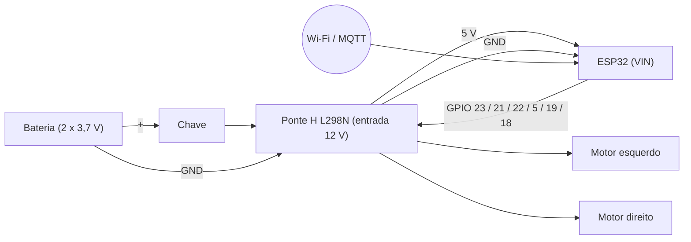

# Eletrônica — Pinagem e Ligações

Desenho básico das ligações: [esquematico_basico.svg](./esquematico_basico.svg). Fotos da montagem em [../mecanica/](../mecanica/).

## Pinagem ESP32 → Ponte H L298N

| Função | Pino do ESP32 | Pino da L298N |
|---|---|---|
| Motor esquerdo — velocidade (PWM) | GPIO 23 | ENA |
| Motor esquerdo — sentido | GPIO 21 | IN1 |
| Motor esquerdo — sentido | GPIO 22 | IN2 |
| Motor direito — velocidade (PWM) | GPIO 5 | ENB |
| Motor direito — sentido | GPIO 19 | IN3 |
| Motor direito — sentido | GPIO 18 | IN4 |
| Referência comum | GND | GND |

Lógica de sentido: IN1/IN3 em HIGH e IN2/IN4 em LOW = frente; o inverso = ré; ambos em LOW = parado.

## Alimentação
- **Bateria do kit:** 2 células Li-ion 3,7 V.
- **Positivo da bateria** → **chave liga/desliga** → entrada de 12 V da L298N (alimenta os motores). A chave corta o positivo da bateria e desliga todo o sistema.
- **Negativo da bateria** → GND da L298N.
- **GND do ESP32** → GND da L298N (referência comum).
- **5 V da L298N** (regulador da própria placa) → **VIN do ESP32**, direto, sem chave nessa linha.

## Diagrama de blocos

## Limites e riscos
- L298N: até 2 A contínuos por canal e queda interna de tensão de até ~2,5 V (dissipada em calor).
- O ESP32 é alimentado pelo regulador de 5 V da L298N. Nenhum reinício foi observado nos testes; ainda assim, medir a tensão em operação para confirmar a margem com a bateria descarregada.
- Pendente: medir a corrente dos motores sob carga e a temperatura da L298N.

## Pendências
- [ ] Esquemático detalhado e projeto da PCB (Gerber).
